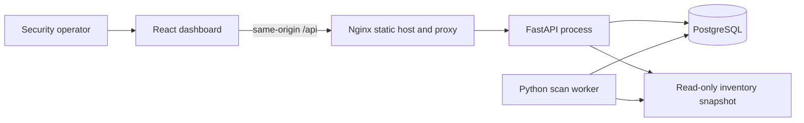
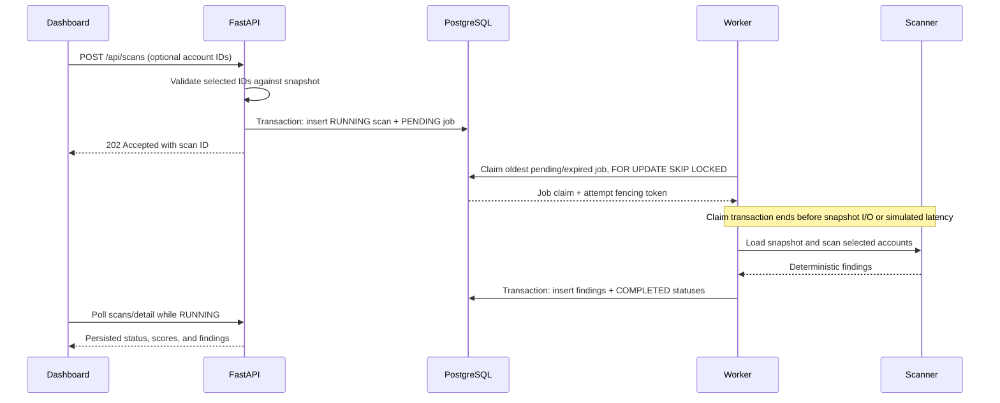
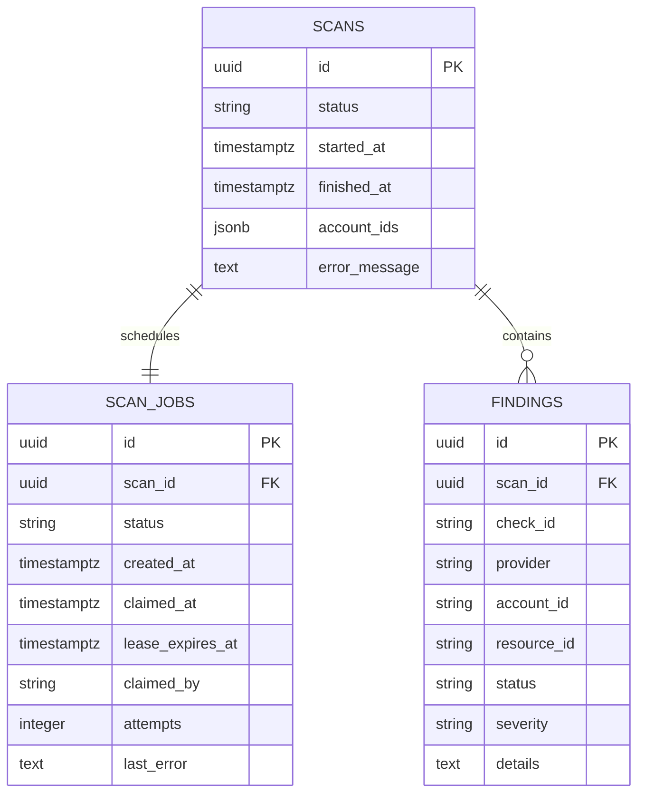
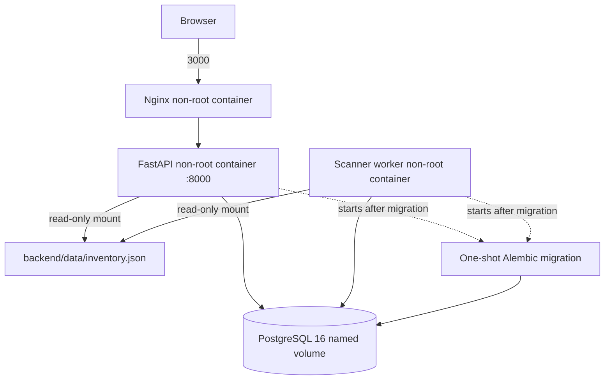

# Mini Gauntlet Architecture

## Context and scope

The system evaluates a supplied simulated snapshot; it makes no live cloud API calls and requires no cloud credentials. The primary runtime is a modular monolith with the HTTP API and scanner worker as independent processes. PostgreSQL is the shared durable coordination and storage module.

## System context

## Runtime modules and responsibilities

| Module | Owns | Interface / seam |
|---|---|---|
| Inventory reader | File access, JSON decoding, root/account/timestamp validation | `load_inventory(path) -> InventorySnapshot` |
| Check registry | Unique check IDs, provider lookup, check catalog | `register(check)`, `checks_for(provider)`, `catalog()` |
| Check implementations | Rule-specific validation and PASS/FAIL semantics | `evaluate(resource, context) -> EvaluationOutcome`; malformed values raise `InvalidResource` |
| Scanner | Collection/error behavior, finding construction, warning logs, bounded account workers | `scan(snapshot, account_ids?) -> list[Finding]` |
| Scoring | Shared score formula and rounding | `posture_score(findings) -> Decimal | None` |
| Scan use cases | Request validation and scan/job creation | Create scan atomically with pending job |
| Persistence adapters | SQLAlchemy storage, queries, transactions, claim locking | PostgreSQL-backed scan/job/finding operations |
| Worker | Job claim, snapshot scan, terminal transitions and recovery | Long-running `python -m app.worker` process |
| HTTP adapter | Pydantic validation/serialization and status codes | Six `/api` routes |
| Dashboard | Scan history/detail, polling, filters, charts, user-visible states | Typed fetch client and React Router pages |

The scanner is deep at its interface: provider-specific semantics live behind a uniform check contract. The registry is the seam for adding checks. The worker's storage adapter is a separate seam for durable claim/finish behavior; API and worker do not duplicate scoring or check logic.

## Scan and job lifecycle

### Failure and recovery

- Snapshot load/validation and unexpected scan errors fail the scan; an API response never pretends that scan succeeded.
- A collection permission error is scoped to its applicable check findings and does not fail the whole scan.
- Malformed resources produce `CANNOT_SCAN` and warning logs without aborting account work.
- Worker claims have a lease and incrementing attempt token. An expired claim is reclaimable; an old worker cannot complete after a newer claim.
- Findings and terminal status commit in one transaction. Partial result sets are not exposed as completed scans. Unique partial indexes cover both resource identities and null-resource collection errors.
- PostgreSQL outage prevents a claim or transaction and surfaces as a worker/API failure. Expired claims recover after the worker/database becomes available.

## Data model

Scans preserve the selected account IDs. Findings retain titles and check metadata as evaluated so historical results remain interpretable if the catalog later changes. Indexes support newest-first scan history, status lookups, and scan/status/severity/provider/account finding queries. Alembic owns schema evolution.

## API and dashboard data flow

The API validates request bodies and query filters with Pydantic. Scan creation reads the snapshot only to validate account selection, then commits the scan/job. The worker performs the costly evaluation. Read endpoints query persisted results and call the shared scoring function; the frontend never recomputes posture. Findings filtering, ordering, and pagination are all server-side.

The React dashboard uses TanStack Query for server state. Scan list and detail queries poll every 1–2 seconds while a scan is RUNNING. Findings poll during execution and refresh after the scan reaches a terminal state. Nginx serves the frontend with a history fallback and reverse-proxies `/api` to FastAPI, avoiding browser CORS configuration.

## Deployment and configuration

Compose starts PostgreSQL, waits for its health check, runs Alembic once, then starts API and worker; the dashboard waits for API health. `DATABASE_URL`, `INVENTORY_PATH`, `SCAN_CONCURRENCY`, `JOB_LEASE_SECONDS`, and `LOG_LEVEL` configure processes. The frontend reaches the API through Nginx; host ports 3000 and 8000 remain available.

## Alternatives and trade-offs

| Choice | Alternative | Reason and trade-off |
|---|---|---|
| Modular monolith, separate API/worker processes | Microservices | Shared domain code and fewer deployment units; processes scale independently without service-to-service protocol complexity. |
| PostgreSQL job queue with `SKIP LOCKED` | FastAPI BackgroundTasks/in-memory queue | Durable jobs and multi-worker safe claims; adds relational locking and migration responsibility. |
| PostgreSQL | SQLite | Required durable multi-process coordination; more local runtime cost, offset by Compose. |
| Bounded `asyncio` account workers | Sequential scan or unbounded task creation | Hides simulated latency while keeping memory/parallelism bounded; requires explicit cancellation/error behavior. |
| JSON snapshot | Live provider SDKs | Reproducible, credential-free assignment scope; no real cloud freshness or live permission discovery. |

## Security and reliability

- Inventory values are untrusted; React renders text and uses no HTML injection API.
- Database access uses SQLAlchemy parameterization; credentials are local Compose-only and excluded from Git.
- Backend, worker, and frontend runtime containers use non-root users. The inventory bind mount is read-only and PostgreSQL uses a named volume.
- Live cloud access is out of scope. `DEPLOY.md` lists least-privilege, read-only permissions if that stretch goal is later approved.
- Logs include scan/account/provider/check/resource identifiers where available. API errors do not return stack traces.
- Health checks and service dependencies are defined in Compose; CI builds the same backend/frontend Dockerfiles.

## Known verification limit

Docker Compose configuration parses, but image builds and runtime startup have not been verified because the Docker Desktop Linux engine is unavailable in this environment. The referenced assignment PDF was not present, and no GitHub remote/CI run exists yet.
