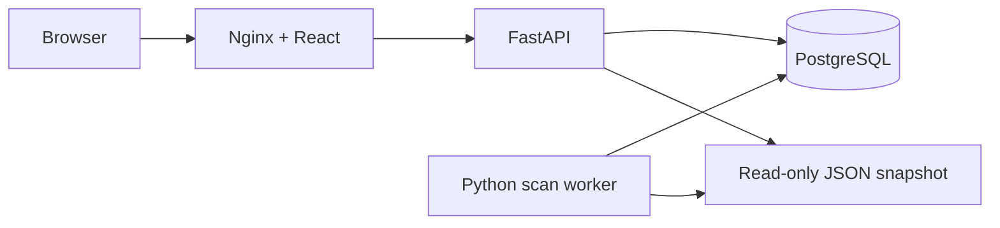

# Mini Gauntlet

Mini Gauntlet scans a supplied, simulated AWS/Azure/GCP inventory snapshot against ten cloud-security checks. It stores scan history and findings in PostgreSQL, runs scans in a separate worker, and provides a React dashboard. The application does not connect to cloud accounts or require cloud credentials.

## Run locally

Prerequisites: Docker Engine with Compose v2.

```powershell
docker compose up --build
```

Open the dashboard at <http://localhost:3000>, the API at <http://localhost:8000>, and interactive API documentation at <http://localhost:8000/docs>. The Compose setup supplies a local-only database password by default; override it with `POSTGRES_PASSWORD` for local use. Do not reuse it in production. PostgreSQL data is stored in the `postgres_data` named volume. The supplied inventory is mounted read-only at `/app/data/inventory.json`.

Useful checks:

```powershell
Invoke-RestMethod http://localhost:8000/api/health
Invoke-RestMethod http://localhost:8000/api/checks
```

The host inventory file is `backend\data\inventory.json`. `INVENTORY_PATH` can point the API and worker to a different mounted snapshot. `SCAN_CONCURRENCY` defaults to four; `JOB_LEASE_SECONDS` defaults to 30.

## Tests and quality checks

From `backend`:

```powershell
python -m pip install -e ".[dev]"
python -m ruff check app tests migrations
python -m pytest -q
```

From `frontend`:

```powershell
npm ci
npm run lint
npm run typecheck
npm test
npm run build
```

Backend tests cover the scanner checks, error isolation, scoring, API contracts, worker claims, and fixture scan results. Frontend tests cover scan initiation, empty states, filters, and safe text rendering.

## Architecture



The backend is a modular monolith with separate API and worker processes. A registry selects checks by provider; the scanner controls account concurrency and isolates malformed resources. PostgreSQL stores scans, findings, and claimable jobs. The worker claims work with row locking and `SKIP LOCKED`; lease expiry and attempt fencing protect recovery and stale workers. Scoring is a shared domain function and excludes `CANNOT_SCAN`. The dashboard polls running scans and delegates filtering, ordering, and pagination to the API.

Requirements, HLD, and implementation contracts are documented in `REQUIREMENTS.md`, `ARCHITECTURE.md`, and `LLD.md`. They are based on the provided engineering brief; the referenced assignment PDF was not present in the workspace.

## Decisions and trade-offs

- An independent database-backed worker is more restart-safe than in-process FastAPI background tasks, while avoiding a separate broker.
- A modular monolith keeps the check registry, domain rules, and persistence contracts small and testable without microservice overhead.
- PostgreSQL is used for durable jobs and safe concurrent claims; SQLite is used only by fast local tests.
- Inventory data is treated as untrusted display text. No inventory-sourced text is rendered as HTML.
- The scanner uses bounded account workers and the snapshot timestamp so results are repeatable.

## Status and unfinished work

Implemented: all ten checks, scoring, inventory validation, REST endpoints, scan worker and persistence, dashboard, component tests, initial migration, Compose files, and CI workflow.

Verified locally: 34 backend tests passed; frontend tests, lint, type checking, and production build passed; `npm ci` completed without vulnerabilities; the Alembic migration upgraded against SQLite. The production dashboard build is split into route chunks.

Not verified yet: Docker image builds and `docker compose up --build` could not run because Docker Desktop's Linux engine was unavailable in this environment. No GitHub remote/CI run is available, so a green CI link cannot yet be supplied. The referenced assignment PDF should be checked when provided, and PostgreSQL behavior should be exercised in Docker before submission.

Future improvements after mandatory acceptance: scan comparison, CIS mapping, CSV export, optional read-only live AWS scanning, API-key protection for scan creation, and software supply-chain scanning.

## AI assistance and effort

AI assistance (GitHub Copilot) was used for design documentation, implementation, tests, and debugging. Review the generated work and verify the actual assignment PDF before submission.

Time spent by phase is **in progress** and should be updated with the implementer's actual elapsed time at final submission; no time estimate is presented as measured effort.

## CI

GitHub Actions is configured in `.github/workflows/ci.yml` for backend lint/tests, frontend lint/typecheck/tests, and both production Docker builds. A successful run link will be added only after the workflow has actually run on the submitted repository.
